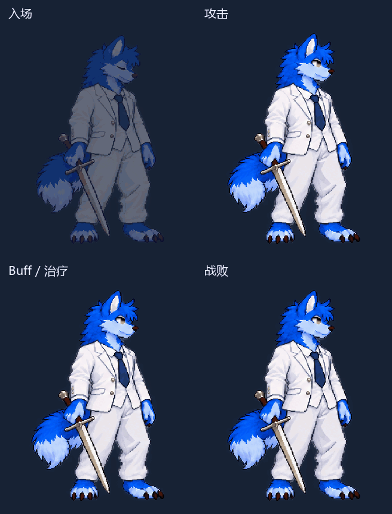

# 克鲁克斯：入场、攻击、Buff／治疗、战败

2026-10-10。用户确认白色西装 idle 与身体居中效果后，生成其余四套。画面面向右方，青年蓝毛灰瞳狼人，略小且蓬松的尾巴，左手不插兜。保持已选定的中间像素细节和固定左上方光源。

生成方式：内置 **image_gen**；以下提示词逐套留存。以已确认高清西装立绘作身份与握剑参考，以 idle v9 作像素风格参考。原始结果为 1536×1024 透明 PNG，保存在各动作的 `generated-sheet.png`。

| 动作 | 时长 | 完整提示词 | 图集 | GIF |
| --- | --- | --- | --- | --- |
| 入场 enter | 0.96 秒 | [prompt](enter/prompt.txt) | [sheet](enter/enter-sheet.png) | [preview](enter/enter-preview.gif) |
| 攻击 attack | 0.78 秒 | [prompt](attack/prompt.txt) | [sheet](attack/attack-sheet.png) | [preview](attack/attack-preview.gif) |
| Buff／治疗 buff | 1.12 秒 | [prompt](buff/prompt.txt) | [sheet](buff/buff-sheet.png) | [preview](buff/buff-preview.gif) |
| 战败 defeat | 1.40 秒 | [prompt](defeat/prompt.txt) | [sheet](defeat/defeat-sheet.png) | [preview](defeat/defeat-preview.gif) |

每套 8 个时间槽，部分关键姿态复用为蓄力或冲击停顿，非 8 个全部不同的姿势。每帧 464×560，4×2 图集。10 FPS 基准配不同 duration 权重；准确时间、源姿态选择见 [manifest.json](manifest.json)。所有动作不循环；战斗中入场和 Buff 结束回待机，攻击结束由战斗编排回待机，战败保留末帧。独立 GIF 为方便检查重复播放，四格 GIF 每轮有额外末帧停留；它们的预览循环不是游戏 loop 设置。

后处理仅做已有图稿的切帧、整数坐标对齐、区域复用、透明度与图集装配，由 [package_actions.py](package_actions.py) 留存。生成结果实际列间距不完全相等，使用测量后的列起点和脚部位置提取，移除相邻姿态进入透明留白的片段。跳过与邻格相交的攻击和过度伸手姿态，以完整姿态加停顿完成节奏。入场前段原地渐显、抬头、尾巴轻摆；攻击双脚固定，蓄力后斜劈；Buff 只替换自由手臂与显式光点，其他区域保留 approved idle，尾巴采样已有延迟尾摆；战败按地面基准下沉跪地，末帧重复并保持。

保留 idle 原有 32 帧全部像素，仅增加右侧 32 像素透明留白，为新动作抬剑留空间。所有状态共用画布，身体锚点 X=264，SpriteFrames 元数据 offset=(-32,0)，保持之前确认的身体居中方式。未按尾巴或剑的包围盒逐帧改变比例或位置。固定部位采用已有像素与阴影；GIF 共享调色板，防止逐帧量化造成颜色跳动。显式出现的入场渐显与施法、挥剑光效是动作的一部分。

游戏文件：[animations.tres](../../../../Resource/Assets/Characters/chalux/animations.tres)、五张图集与高清立绘均在 `Resource/Assets/Characters/chalux/`。入口配置列出五组动画。动画选择可在角色详情中逐套查看。制作记录保留在此目录，各套单帧位于对应 `frames/`。

切帧 QA：检查四套全部单帧的剑、尾巴、自由手与完整轮廓；核对攻击／Buff 首尾与 idle 逐像素相同；核对战败末两帧相同，所有动作统一画布；待机原像素逐像素保留。Godot 运行检查覆盖五组帧数、非循环状态、帧停顿时长、末帧保持、Buff 回待机、被战败打断后不回切、战斗刷新不重置、原地攻击不位移或缩放。新四套是本次交付，仍可根据游戏实看调整动作节奏。

验证结果：Godot 导入成功；UI headless 30 项全部通过，详见 [运行日志](headless/godot-headless.log)；项目回归 1589 项全部通过，详见 [测试日志](unit-tests.log)。正常游戏程序集已恢复。导入日志仍有项目原有 MainRoot 脚本 UID 警告，按文本路径正确加载。

