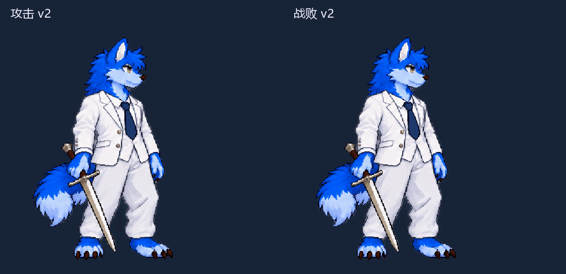

# 克鲁克斯攻击／战败 v2 预览

2026-10-10。用户不满意 v10 的攻击、战败，要求重生成，并明确选择「动作更连贯、有力度」。本版保留已确认的青年蓝毛狼人、灰眼、白色西装、略小的蓬松尾巴、面向右方与中间像素细节，只制作两套新的动作预览。

使用内置 **image_gen**。以 [idle v9](../idle-suit-v9/frames/idle-01.png) 作像素风格、站姿与光源参考，[高清立绘](../../crux-suit-right-v5.png) 作身份与服饰参考。完整提示词：[攻击](attack/prompt.txt)、[攻击固定腿部修正](attack/stance-fix-prompt.txt)、[战败](defeat/prompt.txt)。攻击先生成完整连续剑路，再用内置工具修正下半身的滑步倾向，保留每帧剑在腿部前方的完整轮廓。最终原图均为各目录的 `generated-sheet.png`；`attack/motion-draft.png` 留存初次运动设计，便于对应修正提示词。

| 动作 | 时间槽 | 动作时长 | 预览 | 透明图集 |
| --- | --- | --- | --- | --- |
| 攻击 v2 | 12 | 0.98 秒 | [GIF](attack/attack-preview.gif) | [4×3 图集](attack/attack-sheet.png) |
| 战败 v2 | 12 | 1.55 秒 | [GIF](defeat/defeat-preview.gif) | [4×3 图集](defeat/defeat-sheet.png) |

攻击为抬剑、肩肘蓄力、快速斜劈、低位随势、收回与回到待机；加强回收中间姿态，非用重复蓄力帧代替缺少的动作。刀光只跟随主要下劈。尾巴有跟随身体转动的反应。战败保持同一单膝支撑结构，逐步屈膝失力、落膝、左掌扶自己膝部、低头、尾巴落下并保持，不在后半段切换两膝姿势或重新起身。

生成器实际输出尺寸与请求的等分网格不同：攻击 1448×1086，战败 1536×1024。按实际列起点与透明行间隙切帧，每个动作始终使用同一个最近邻缩放比例，保持肢体比例；地面基准 Y=535，攻击以左脚中心 X=202 对齐，原地站姿由最终生成图本身提供，不用整条底部贴图覆盖武器。清除提取留白中相邻姿态的浮动片段，保留完整剑路和刀光。攻击首尾采用已确认的 idle 帧，战败首帧采用 idle。所有预览单帧共用 **640×560** 透明画布，增加挥剑空间；单帧在各自 `frames/`，装配过程在 [package_preview.py](package_preview.py)，参数在 [manifest.json](manifest.json)。此画布是当前预览交付尺寸，尚未调整游戏显示画布。

GIF 采用整套共享调色板，末帧有额外停顿便于观察；GIF 的重复播放用于预览，战败在游戏中应非循环并保持末帧。逐套检查全部 12 帧的剑、尾巴、完整肢体、脚部衔接和地面基准，确认没有残留相邻姿态的刀光／剑尖碎片，没有底部矩形贴图或多余待机剑尖。攻击首尾像素一致。两套 PNG 图集与24张单帧都保留透明度。

本次为用户要求的新版预览，未替换游戏内 v10 资源，入场、idle、Buff／治疗保持已有版本。未改游戏代码，也未重复运行代码回归测试。

